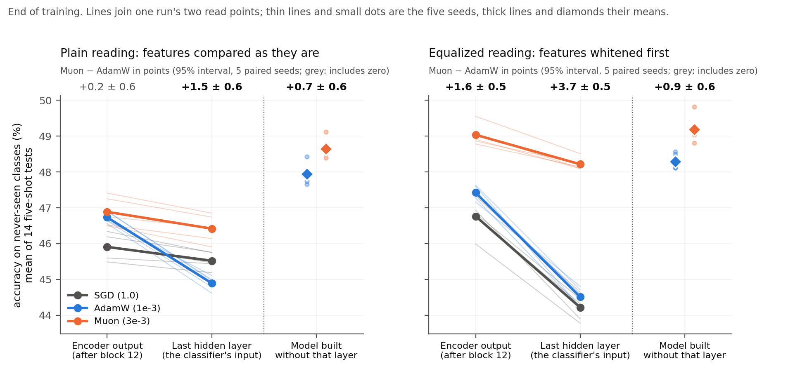
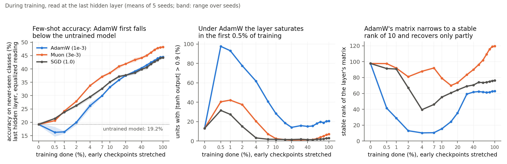

# Does the optimizer change few-shot learning of never-seen classes?

**AdamW, Muon and SGD on a ViT-S/16 trained from scratch, tested on classes it never saw.**

This repository holds the results of the study: its figures, the write-up ([REPORT.md](REPORT.md)), the script
that draws the figures, the numbers they are drawn from, and the code that trained and tested the models
(`icl/`). It is the vision-transformer part (Section 6 and
Appendix G) of a course report on how the optimizer shapes in-context learning. The report's first part, in-context regression and ciphers in small
sequence models, is at https://github.com/EshMis/optimizer-icl.

## What was done

A ViT-S/16 (12 blocks of width 384, 21.9M weights; the big_vision plain-ViT recipe) was trained from scratch
to classify 344 long-tailed Objects365 classes from 1.2 million cut-out images, for 90 epochs (107,859 steps of
1,024 images), with AdamW at 1e-3, Muon at 3e-3 and SGD at 1.0, five paired seeds each. Within a seed every
optimizer starts from the same weights and sees the same images in the same order. In a Muon run, Muon trains
the 72 matrices inside the blocks and the matrix of the last hidden layer; AdamW trains the rest.

The dog class and 20 other classes were held out of training. After training the model is frozen and given 14
five-shot tests on classes it was never trained to tell apart (dog breeds, wolves and foxes, cat breeds, the cat
family, bird species, ImageNet classes, the held-out Objects365 classes): five labeled images per class, then a
new image, which goes to the class with the nearest mean feature vector. No weights change. Features are read
at the encoder output (mean over patches after block 12) and after the last hidden layer (a linear map and a
tanh, which is what the classifier reads), either as they are (plain) or whitened (equalized).

Control runs locate the difference in the model: a model built without the last hidden layer (five seeds each
under AdamW and Muon), a 2x2 at learning rate 1e-3 of who trains the 12 blocks and who trains the last hidden
layer's matrix (three seeds per cell), and single runs with Muon on one kind of matrix only or with a change of
optimizer after 10% of training. 48 training runs in all, about 690 A100 GPU-hours, including the learning-rate
sweeps.

## Results in brief

Accuracy in %, means over five seeds; differences are seed by seed with 95% Student-t intervals. The full table
is [numbers.md](numbers.md), written by the figure script.

| Measure | AdamW 1e-3 | Muon 3e-3 | SGD 1.0 | Muon − AdamW | SGD − AdamW |
|---|---|---|---|---|---|
| Trained classes, validation top-1 | 71.44 | 73.62 | 69.61 | +2.17 ± 0.38 | −1.83 ± 0.65 |
| Rarest fifth of trained classes | 34.89 | 42.43 | 30.82 | +7.54 ± 1.70 | −4.07 ± 2.23 |
| Never-seen, encoder output, plain | 46.73 | 46.89 | 45.91 | +0.16 ± 0.59 | −0.82 ± 0.48 |
| Never-seen, encoder output, equalized | 47.42 | 49.03 | 46.76 | +1.61 ± 0.52 | −0.66 ± 0.75 |
| Never-seen, last hidden layer, plain | 44.90 | 46.42 | 45.52 | +1.52 ± 0.58 | +0.62 ± 0.41 |
| Never-seen, last hidden layer, equalized | 44.51 | 48.21 | 44.22 | +3.70 ± 0.48 | −0.29 ± 0.72 |



1. **Half or more of Muon's lead on never-seen classes is made in one layer.** Crossing the last hidden layer
   costs AdamW 1.83 (plain) and 2.91 (equalized) points and Muon 0.47 and 0.82. The layer costs AdamW more by
   1.37 ± 0.15 and 2.09 ± 0.47 points, with the same sign in five of five seeds (exact permutation p = 0.008,
   the smallest five seeds allow). That is 90% (plain) and 56% (equalized) of Muon's lead where the classifier
   reads; the rest is already there at the encoder output.
2. **Under AdamW that layer saturates in the first 0.5% of training.** 97.6% of its units are pinned by the
   tanh, the stable rank of its matrix falls from 98 to 10, and few-shot accuracy read there falls below the
   untrained model's (16.3% against 19.2%) in five of five AdamW seeds, in none of the Muon or SGD seeds.



3. **Which matrices Muon has to train depends on the measure** (the 2x2 at learning rate 1e-3). On trained
   classes the blocks carry the gain (+1.70 ± 0.18; the last matrix +0.29 ± 0.28). On never-seen classes at the
   last hidden layer the layer's own matrix has the clear effect (+0.82 ± 0.23 plain, +1.68 ± 0.52 equalized);
   the blocks' effect is not established (+0.57 ± 1.01, +0.88 ± 1.00).
4. **In a model built without that layer Muon's lead is small.** +0.70 ± 0.58 (plain) and +0.90 ± 0.61
   (equalized), ahead in every seed.
5. **SGD does not settle whether few-shot accuracy follows accuracy on trained classes.** It is 1.8 points
   below AdamW on trained classes; on never-seen classes it is ahead or behind depending on the read-out.

Limits: one model, one dataset, and a few-shot test on frozen features, which is not in-context learning
inside the transformer. The control runs have three seeds, the optimizer swaps and some splits one run each.
Why the last hidden layer suffers under AdamW when the blocks do not is not explained.

## Figures

| File in `figs/` (.png and .pdf) | Report | What it shows |
|---|---|---|
| [`vit_read_points`](figs/vit_read_points.png) | Figure 5 | Never-seen classes at the end of training, seed by seed, at the encoder output, at the last hidden layer and in the model built without that layer; plain and equalized |
| [`vit_training`](figs/vit_training.png) | Figure 6 | The same test at the 17 checkpoints, with the share of saturated units and the stable rank of the last hidden layer's matrix |
| [`vit_tests`](figs/vit_tests.png) | Figure G1 | Muon − AdamW for each of the 14 tests, at both read points, in both readings |
| [`vit_depth`](figs/vit_depth.png) | Figure G2 | Muon − AdamW and SGD − AdamW read after every layer of the model |
| [`vit_controls`](figs/vit_controls.png) | Figure G3 | The 2x2 at learning rate 1e-3: what Muon on the blocks adds and what Muon on the last matrix adds |
| [`vit_updates`](figs/vit_updates.png) | Figure G4 | Share of each weight update in its strongest singular direction, for attention and MLP matrices |
| [`vit_rare_classes`](figs/vit_rare_classes.png) | Figure G5 | Trained-class accuracy by class frequency: Muon − AdamW and SGD − AdamW per fifth |

## Regenerating them

```bash
python make_figs.py            # writes figs/*.png, figs/*.pdf and numbers.md
```

It needs only `numpy` and `matplotlib` and reads `data/vit_page_data.json`. Every plotted value and every number
in `numbers.md` comes from that file; none is typed into the script. Colors and plot style are those of the
report's regression figures.

## Code

`icl/` is the code of the study, with its tests. It runs from the repository root as `python -m icl.<module>`
and needs `numpy`, `torch` (a version that has `torch.optim.Muon`) and `Pillow`; the analysis scripts also use
`matplotlib` and `scipy`.

| Files in `icl/` | What they do |
|---|---|
| `train.py`, `vit.py`, `optim.py` | Train the ViT-S/16 from scratch with AdamW, Muon or SGD. Runs with the same seeds start from the same weights and see the same images in the same order. |
| `o365.py`, `pack.py`, `data.py`, `aug.py`, `anchors.py` | Data: Objects365 turned into one-label cut-outs, packed into flat files, with classes held out and the recipe's augmentation; a check of a test set's class numbering. |
| `fewshot.py`, `features.py` | The few-shot test on frozen features, at every checkpoint of a run. |
| `probe.py`, `linear.py`, `cka.py` | Read-outs after every layer (few-shot accuracy, the rank of the features, saturation of the last hidden layer, weight spectra), the ridge classifier, and how alike the layers of different runs are. |
| `why.py`, `seeds.py`, `summary.py`, `curves.py`, `flops.py` | Analysis of finished runs: seed-by-seed comparisons, curves along training, compute. |
| `seq.py`, `seqcross.py`, `seqseries.py`, `seqsummary.py` | The small transformer that learns to use examples on frozen ViT features (Appendix G.6 of the report). |
| `results/robust/robust.py`, `results/page_data.py` | The statistics of Section 6 and Appendix G, and the script that gathers every number into the data file behind the figures. |
| `RECIPE.md` | Every training setting and where it comes from in the big_vision source. |
| `tests/` | The test suite: `python -m pytest icl/tests`. |

The analysis scripts read the per-run read-outs from `icl/results/data/runs/`, which are not in this repository.
They show how each number was computed, but they cannot be rerun from the repository alone.

## What is here and what is not

- **Here:** the write-up (`REPORT.md`), the code (`icl/`), the figures, `make_figs.py`, `numbers.md`, and
  `data/vit_page_data.json`: per-seed end-of-training
  values, means and seed ranges at the 17 checkpoints, and the per-test, per-layer and control-run differences
  with their intervals. `extract_data.py` records how the data file was taken from the study's results page.
- **Not here:** the images, the per-run read-outs and logs, the model checkpoints, the job scripts for the
  cluster the runs were made on, and the source of the study's results page. The data file was computed from
  the per-run read-outs by the analysis scripts in `icl/`.
