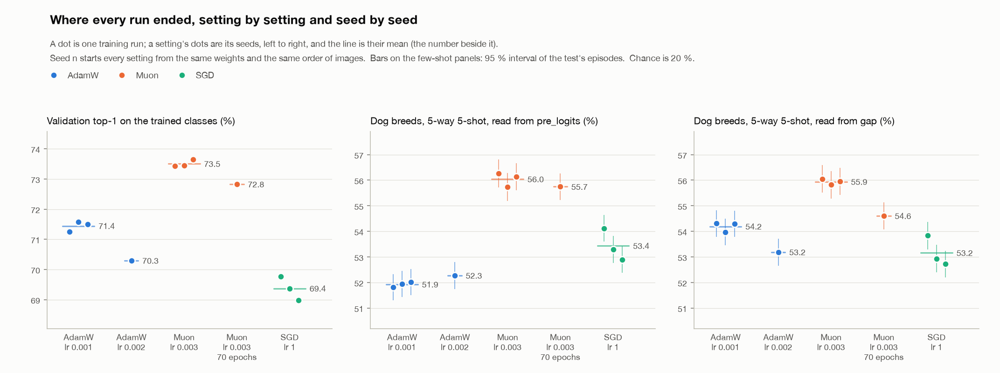
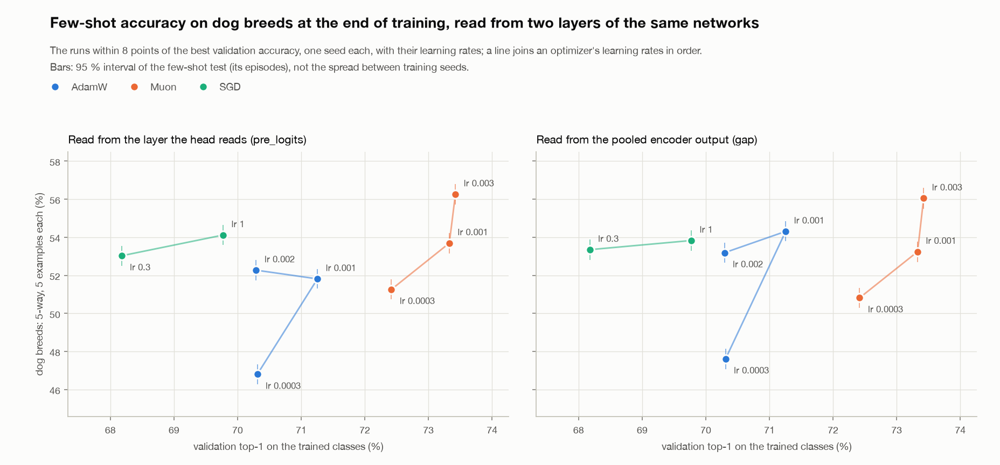
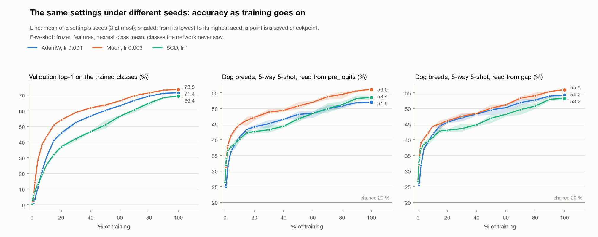
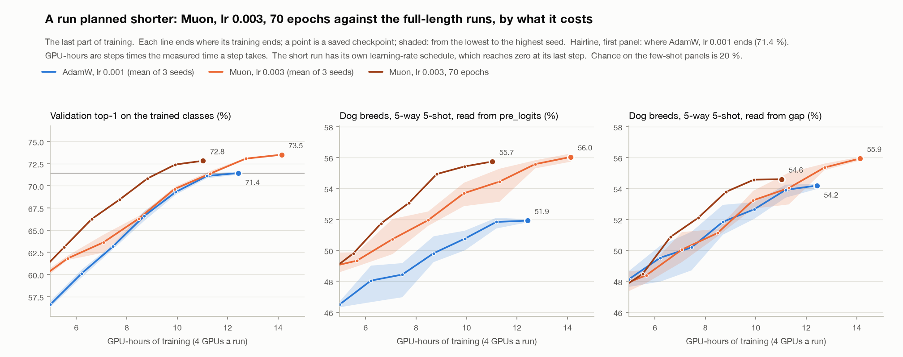
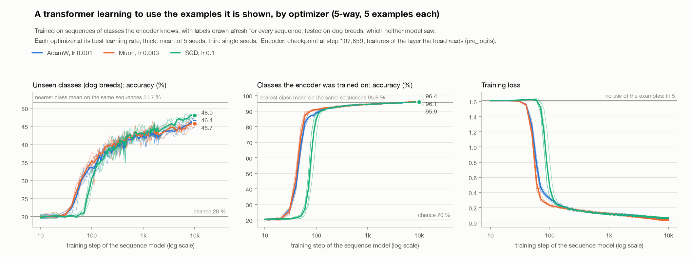
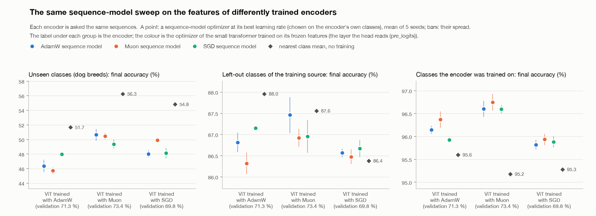

# Does the optimizer change in-context learning?

**AdamW, Muon and SGD on a ViT-S/16 trained from scratch, tested on classes it never saw at seventeen points along
training.**

We train one vision transformer from scratch three ways (with AdamW, with Muon and with SGD) on an image set from
which every dog has been removed. Along each run we ask how well the model can use a handful of labelled examples
of classes it has never seen (dog breeds), in two ways: with a fixed rule on its frozen features, and with a second
small transformer that has to *learn* to use the examples in its context. This page says what was done and what
came out. It is a snapshot of work in progress (November 2026): one architecture, one training set, eighteen ViT
runs.

**Final results.** The study has since grown to 48 runs, with five seeds of each main setting and control runs
that locate the difference in the model. The final numbers and the figures used in the course report are in
[results/report/](results/report/README.md). Where they differ from the three-seed numbers on this page, the
five-seed numbers are the ones to use.

## In short

- **On the classes it was trained on, Muon ends 2.1 points above the AdamW recipe and SGD 2.1 below, and three
  seeds agree.** Validation top-1 is 73.5 %, 71.4 % and 69.4 %; seeds of one setting differ by 0.2 to 0.8 points.
- **On classes it never saw, Muon's features are better where the classifier head reads them and about level one
  layer earlier.** Over 14 groups of unseen classes with 5 examples per class, Muon is clearly ahead of AdamW on 8
  and behind on none when the features are read from the head's input layer; read from the pooled encoder output
  it is ahead on 5, behind on 1 and level on average. On dog breeds it is ahead on both layers (4.1 and 1.7 points).
- **The learning rate matters as much as the optimizer.** Raising one optimizer's learning rate to its best value
  moved few-shot accuracy on dog breeds by 5 points while validation accuracy moved by 1.
- **Few-shot ability has no onset of its own during the ViT's training.** It is above the untrained network at the
  first checkpoints and then grows with accuracy. Half of the final gain is there after about 4 % of training under
  Muon and 7 % under AdamW.
- **A model that has to learn to use examples acquires the ability abruptly, within tens of steps, under every
  optimizer.** Which optimizer trains that model changes the result by at most 2 points; which ViT its features
  come from changes it by about 4.
- **Muon needs 14 % more GPU time per epoch, yet a Muon run planned for 70 epochs ends 1.4 points above the
  90-epoch AdamW run for 11 % less GPU time.**

## What was trained

**Model.** The plain ViT-S/16 of Beyer, Zhai and Kolesnikov, "Better plain ViT baselines for ImageNet-1k"
(arXiv 2205.01580), as implemented in big_vision: width 384, depth 12, patch 16, 224-pixel input, fixed sin-cos
position embedding, global average pooling, and a `pre_logits` layer (linear, then tanh) in front of the linear
head. It has 21.9 million parameters with our 344 classes.

**Recipe.** That paper's 90-epoch recipe, unchanged for the baseline: batch 1,024, 107,859 steps, 10,000 steps of
warm-up, cosine decay to zero, gradient clipping at global norm 1, Inception crop and flip, RandAugment (2 ops,
magnitude 10), mixup 0.2. [icl/RECIPE.md](icl/RECIPE.md) lists every setting and where it comes from in the source.
One known departure: the forward pass runs under bf16 autocast, where the source computes in float32.

**Optimizers.**

- *AdamW* is the recipe's own optimizer: learning rate 1e-3, weight decay 0.1 in PyTorch's convention.
- *Muon* is `torch.optim.Muon` on the 2D weight matrices inside the transformer blocks and on the `pre_logits`
  matrix (momentum 0.95, Nesterov, five Newton-Schulz steps, `adjust_lr_fn="match_rms_adamw"`). The patch
  embedding, the head, the biases and the LayerNorm parameters stay with the recipe's AdamW. Warm-up, schedule,
  clipping and decay are the recipe's.
- *SGD* has Nesterov momentum 0.9 and the same schedule.
- Each optimizer was run at several learning rates, with the weight decay per step held fixed: AdamW at 3e-4, 1e-3,
  2e-3 and 3e-3; Muon at 3e-4, 1e-3 and 3e-3; SGD at 0.03, 0.1, 0.3 and 1.0.

**Data.** Training images are cut-outs of labelled objects from Objects365 (Shao et al., ICCV 2019). We read the
copy in the FineVision collection (`HuggingFaceM4/FineVision`, subset `objects365_qa`: 1.67 million photos, 24.3
million boxes, 365 classes). A box becomes a single-label image if its short side is at least 64 pixels and its
aspect ratio at most 6; the cut is the box widened by a tenth on each side; a class gives at most 12,000 training
cut-outs. One photo in 25 is set aside, whole, for validation.

**What is left out.** *Dog*, entirely. A photo that contains a dog, a cat or a lion contributes cut-outs of those
classes only, so no labelled dog sits in the background of another object's cut-out either. What remains is dogs
that Objects365 did not label, and 201 of the 8,353 cat and lion cut-outs, which overlap a labelled dog's box.
Twenty more classes, drawn at random, are left out as a control. That leaves 344 classes and 1,227,201 training
images.

**Runs.** Eighteen ViT runs on four A100 GPUs each: one for each of the eleven learning rates above, two more seeds
for the best setting of each optimizer (AdamW 1e-3, Muon 3e-3, SGD 1.0), and one Muon 3e-3 run planned for 70
epochs with its own schedule. Runs with the same seed start from identical weights and see the same images in the
same order with the same augmentations, whatever the optimizer. No run was interrupted.

No images, checkpoints or training logs are in this repository.

## How in-context ability is measured

Each run saves 17 checkpoints: after 0, 0.5, 1, 2, 4, 7, 10, 15, 20, 30, ..., 100 % of its steps.

**1. Few-shot classification on frozen features, at every checkpoint.** An episode draws N classes the network was
never trained on, k labelled examples of each, and 15 more images per class to classify. Features come from the
frozen network, are centred and scaled to unit length, and each query goes to the nearest class mean. Nothing is
trained. Two layers are read: `pre_logits` (the input of the classifier head, the layer big_vision's own few-shot
evaluator uses) and `gap` (the pooled encoder output, one layer earlier). k is 1, 5 or 10, a test has 1,000
episodes, and every run and checkpoint is asked the same episodes. On a 5-way test chance is 20 %, and the untrained
network scores 26.5 %.

The unseen classes are ImageNet-1k validation images (35 per class) in 14 pools: dog breeds (118 breeds, asked 5,
20 and 118 at a time), domestic cats, the cat family, bird species, wolves and foxes, ImageNet classes at large,
and the 20 left-out Objects365 classes. Dogs, wolves and foxes were never in training. Cats and birds were, but
only as coarse classes (Cat, Parrot, Pigeon and the like), never by breed or species; the same goes for many other
ImageNet classes.

**2. A sequence model that has to learn to use examples.** A small transformer (width 256, four blocks, 3.3
million parameters) reads 5 classes with 5 (image feature, label) examples each, plus one more image, and has to
name that image's label. The five labels are assigned afresh at random in every sequence, so nothing about a class
can be stored in the weights: the only way to answer is to use the examples. It is trained on frozen ViT features
of the 1.2 million training images and tested on dog breeds, on the left-out Objects365 classes and on validation
images of the trained classes. It is itself trained with AdamW, Muon or SGD (five learning rates each, five seeds,
10,000 steps), on the features of ViTs trained with each of the three optimizers. Nearest class mean on exactly the
same test sequences is the yardstick.

## Results

### Where every run ended

| optimizer, learning rate | runs | validation top-1 | dog breeds, 5-way 5-shot, `pre_logits` | the same, `gap` | GPU-hours a run |
|---|---|---|---|---|---|
| AdamW 3e-4 | 1 | 70.3 % | 46.8 % | 47.6 % | 12.4 |
| **AdamW 1e-3 (the recipe unchanged)** | 3 seeds | **71.4 %** (71.3 to 71.6) | 51.9 % (51.8 to 52.0) | 54.2 % (54.0 to 54.3) | 12.4 |
| AdamW 2e-3 | 1 | 70.3 % | 52.3 % | 53.2 % | 12.4 |
| AdamW 3e-3 | 1 | 12.3 % (collapsed) | 36.5 % | 36.0 % | 12.5 |
| Muon 3e-4 | 1 | 72.4 % | 51.3 % | 50.8 % | 14.1 |
| Muon 1e-3 | 1 | 73.3 % | 53.7 % | 53.2 % | 14.1 |
| **Muon 3e-3** | 3 seeds | **73.5 %** (73.4 to 73.6) | 56.0 % (55.7 to 56.3) | 55.9 % (55.8 to 56.0) | 14.1 |
| Muon 3e-3, 70 epochs | 1 | 72.8 % | 55.7 % | 54.6 % | 11.0 |
| SGD 0.03 | 1 | 26.4 % | 37.6 % | 39.4 % | 12.3 |
| SGD 0.1 | 1 | 54.3 % | 43.8 % | 45.7 % | 12.4 |
| SGD 0.3 | 1 | 68.2 % | 53.0 % | 53.3 % | 12.4 |
| **SGD 1.0** | 3 seeds | **69.4 %** (69.0 to 69.8) | 53.4 % (52.9 to 54.1) | 53.2 % (52.7 to 53.8) | 12.4 |

For three seeds: their mean, with the lowest and the highest in brackets. A few-shot figure carries about ± 0.5
points of its own (95 %, over the 1,000 episodes).

Below, a difference from the AdamW recipe is called *clear* when its 95 % interval leaves out zero. For a setting
with three seeds that is Student's t on the three seed-by-seed differences; for a setting run once it is the
interval in which a fourth seed of the AdamW recipe would fall. With three seeds these intervals are wide.

- **Muon is 2.1 points above AdamW on validation top-1 in every seed** (+2.2, +1.9, +2.1; interval +1.7 to +2.5).
  SGD is 2.1 points below (interval -3.4 to -0.7).
- **The baseline is not held back by its learning rate.** AdamW at 2e-3 ends 1.2 points under the recipe's 1e-3,
  more than another seed would explain, and at 3e-3 it collapses during warm-up. The published learning rate is the
  best of the four.

### Few-shot on classes never trained on

Over the 14 pools of unseen classes, with 5 examples per class and three seeds:

| against the AdamW recipe | layer | clearly ahead on | clearly behind on | neither on | mean difference |
|---|---|---|---|---|---|
| Muon 3e-3 | `pre_logits` | 8 pools | 0 | 6 | +1.3 points |
| Muon 3e-3 | `gap` | 5 pools | 1 | 8 | -0.1 points |
| SGD 1.0 | `pre_logits` | 2 pools | 2 | 10 | +0.6 points |
| SGD 1.0 | `gap` | 1 pool | 3 | 10 | -0.8 points |

- **Muon is ahead on the layer the head reads.** From `pre_logits` it is clearly ahead on dog breeds, bird species
  and ImageNet classes at large, at every size asked, and clearly behind nowhere.
- **One layer earlier the lead is narrower.** From `gap` it is clearly ahead on dog breeds and on ImageNet classes
  at large, clearly behind on five bird species, and level on average.
- **On dog breeds it is ahead on both layers**: by 4.1 points from `pre_logits` (interval +3.3 to +4.9) and by 1.7
  from `gap` (+1.5 to +2.0).
- **SGD and AdamW cannot be told apart on unseen classes** with three seeds, although SGD is 2 points lower on
  validation; its seeds differ more.
- With 1 and with 10 examples per class the counts come out the same way (for Muon 7 ahead and 1 behind, and 8 and
  0, from `pre_logits`; 6 and 0, and 4 and 0, from `gap`).

So whether "Muon gives features that generalise better to new classes" holds depends on where the features are
read. Every pool is in [results/round2/seeds/seeds.md](results/round2/seeds/seeds.md).

### The learning rate matters as much as the optimizer

Each point is one run, and a line joins one optimizer's learning rates. Within AdamW, going from 3e-4 to the
recipe's 1e-3 adds 1.0 point of validation accuracy and 5.0 points on dog breeds (6.7 from `gap`). Within Muon,
going from 3e-4 to 3e-3 adds 1.0 point of validation accuracy and 5.0 on dog breeds (5.2 from `gap`). These lower
learning rates were run once each, but the steps are several times what seeds differ by. Validation accuracy alone
would not have found the learning rate that transfers best.

### When the ability appears

- **There is no moment of emergence.** Few-shot accuracy on dog breeds is above the untrained network from the
  first checkpoint under Muon and SGD (0.5 % of training) and from the third under AdamW (2 %), in every seed and
  on both layers. After that it rises along with validation accuracy.
- **Muon gets there earlier.** Half of the final gain is there after 3.7 to 4.8 % of training under Muon, 6.5 to
  8.6 % under AdamW and 6.7 to 9.4 % under SGD (`pre_logits`, the three seeds). Nine tenths take until 64 to 81 %
  of training under all three.
- **At equal validation accuracy the optimizers are close.** Plotted against validation accuracy instead of
  training time, the three few-shot curves stay within one to three points of each other and cross
  ([results/round2/vit-s0/best.png](results/round2/vit-s0/best.png), lower right).

### What the choice costs

Muon processes 8,700 images a second where AdamW and SGD process 9,900, so a 90-epoch run takes 14.1 GPU-hours
against 12.4. A Muon run planned for 70 epochs, with its schedule brought to zero at its own last step, ends at
72.8 % validation top-1 for 11.0 GPU-hours: 1.4 points above the 90-epoch AdamW runs for 11 % less GPU time. On
unseen classes read from `pre_logits` it is clearly ahead of AdamW on 10 of the 14 pools and behind on none; read
from `gap` it is level with AdamW on 13 pools and clearly behind on one (domestic cats). Against the 90-epoch Muon
runs it gives up 0.7 points of validation accuracy for
22 % less GPU time. This is one run; how much shorter Muon can go and still match the AdamW recipe was not run.

### Learning to use examples: the sequence model

The figure and the three points under it are for the features of the AdamW ViT at the end of its training.

- **Here the ability does appear abruptly.** The loss stays at ln 5, the value of a model that ignores the
  examples, for the first 30 steps under AdamW and Muon and 64 under SGD, and then falls within a few tens of
  steps. Accuracy on the trained classes goes from a tenth to nine tenths of its final gain between steps 31 and
  97 (AdamW), 31 and 66 (Muon) and 61 and 107 (SGD), out of 10,000.
- **When it appears is set mostly by the learning rate.** Under AdamW the half-way step moves from 201 to 33 as the
  learning rate goes from 3e-5 to 3e-3. At each optimizer's best learning rate it is step 47 (AdamW), 44 (Muon)
  and 80 (SGD).
- **The three optimizers end alike.** On the trained classes all three end between 95.9 and 96.4 %, just above
  nearest class mean on the same sequences (95.6 %). On dog breeds they end at 46 to 48 %, below nearest class
  mean (51.7 %): the learned rule does not beat the fixed one on classes the ViT never saw.

- **Which ViT made the features matters more than which optimizer trains the sequence model.** On dog breeds, with
  the learning rate chosen on the left-out classes, the sequence models reach 48.0 to 49.1 % on the AdamW ViT, 51.6
  to 53.4 % on the Muon ViT and 48.0 to 49.9 % on the SGD ViT. At most 2 points lie between sequence-model
  optimizers, about 4 between the AdamW and the Muon ViT.
- **The picture repeats on every ViT**: an abrupt start after 30 to about 100 steps, an end just above nearest
  class mean on the trained classes and 3 to 7 points below it on dog breeds.
- **Along the ViT's training the learned rule follows the features**
  ([results/round1/seq-series/series.png](results/round1/seq-series/series.png)): on dog breeds 31 to 34 % on the
  untrained ViT and 46 to 48 % at the end. Even on the untrained ViT's features a sequence model learns to use
  examples (49 to 51 % on the trained classes, where nearest class mean gets 33.8 %).

All sequence models read `pre_logits` features, the layer on which the Muon ViT compares best with the AdamW one.

## What this does not show

- **One architecture, one training set, one family of unseen classes.** ViT-S/16 on Objects365 cut-outs, with dogs
  left out. Nothing here says the same holds for a larger model, for language, or for other data.
- **Few seeds.** Three seeds exist for the best setting of each optimizer only. Every other run, the 70-epoch Muon
  run and AdamW 2e-3 included, was made once.
- **Tuning.** AdamW has the published recipe with four learning rates tried; its betas, warm-up and decay were not
  varied. Muon's settings other than the learning rate are defaults. SGD's best learning rate is the highest one
  tried.
- **The published accuracy is not reproduced.** The recipe's 76.5 % is for ImageNet-1k. Our runs train on other
  data, for which no published number exists, so the baseline's 71.4 % has nothing to be checked against.
- **Two different things are called in-context ability here.** On the ViT it is few-shot classification with a
  fixed rule on frozen features, which measures the features. Only the sequence model learns to use examples, and
  it was trained on one layer's features of one seed's ViTs.

## In this repository

`icl/` is the code behind every number above, with its tests; `results/` holds every figure and the table it was
drawn from, by round. `results/report/` holds the final five-seed results: the report's figures, the script that
draws them and the numbers they are drawn from.
