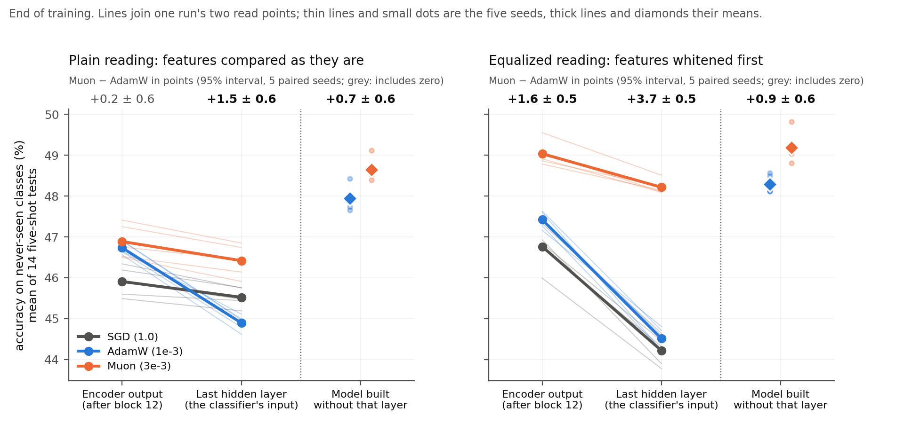
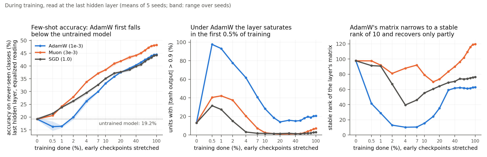
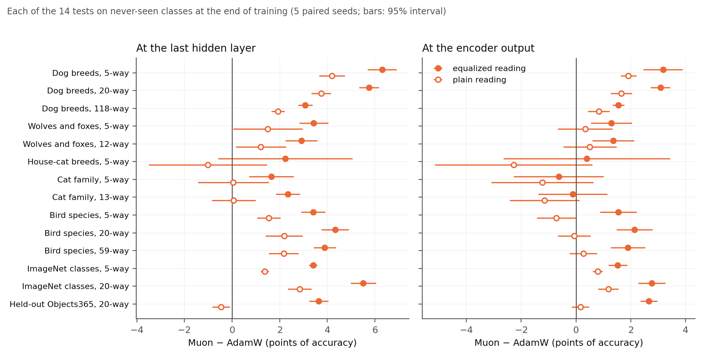
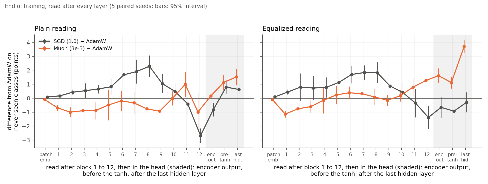
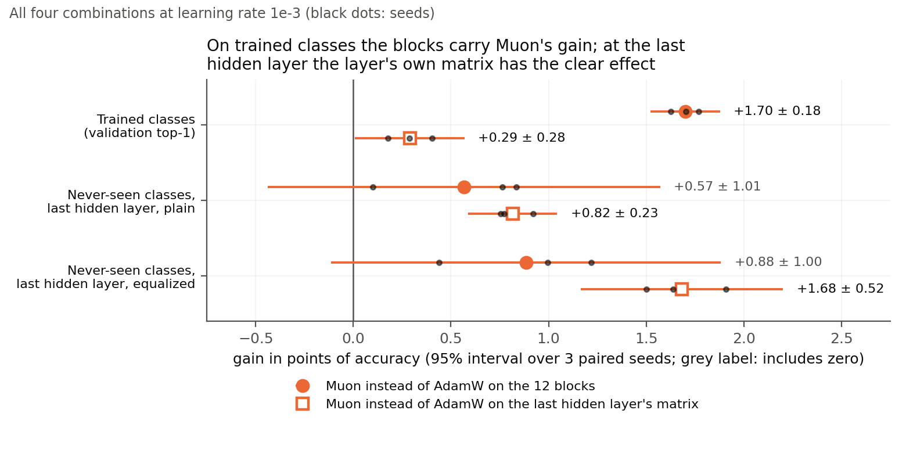
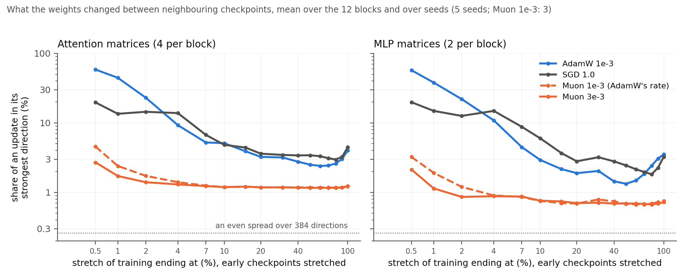
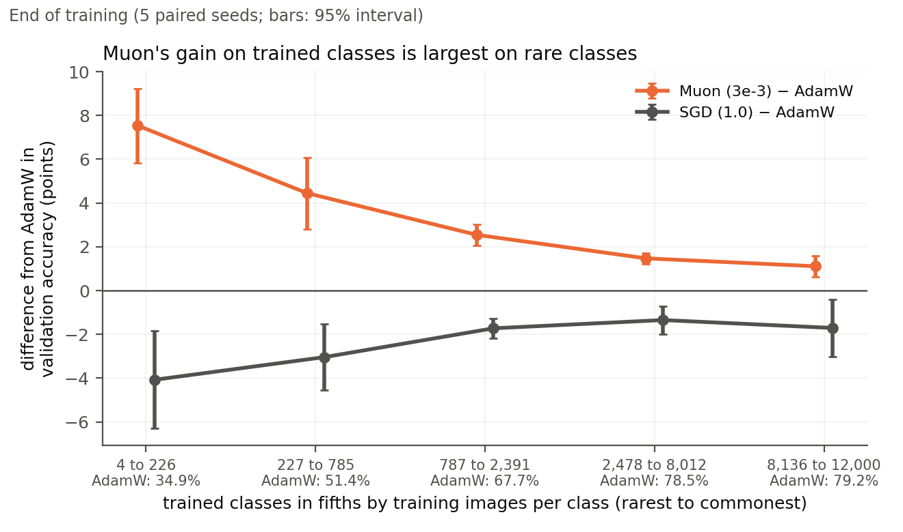

# Report: few-shot learning of never-seen classes in a vision transformer

This is the vision-transformer part (Section 6 and Appendix G) of the course report "How Does the Optimizer
Shape In-Context Learning? Muon vs AdamW". Section, figure and table numbers are those of the full report. Its
first part, in-context regression and ciphers in small sequence models, is at
https://github.com/EshMis/optimizer-icl. Every number below is in [numbers.md](numbers.md) or in
`data/vit_page_data.json`, and every figure is drawn by `make_figs.py`.

## 6 A vision transformer: few-shot learning of never-seen classes

The regression and cipher results of the report's first part come from small models trained to learn in
context. This part asks whether the optimizer also changes how well a realistic model, trained as an ordinary
classifier, learns from a few examples. We trained an image classifier and asked how well its frozen features
separate classes it never saw, given five examples of each.

### 6.1 Setup

**Model and training.** We trained a ViT-S/16 from scratch (12 blocks of width 384, about 21.9M weights) to
classify 344 long-tailed Objects365 classes from 1.2 million cut-out images for 90 epochs, with AdamW at 1e-3,
Muon at 3e-3 and SGD at 1.0. Each rate was the best in a sweep. Runs are paired: within a seed every optimizer
starts from the same weights and sees the same images in the same order. Each optimizer has five seeds. In a
Muon run, Muon trains the 72 matrices inside the blocks and the matrix of the last hidden layer, and AdamW
trains the rest. After the 12 blocks, the original ViT head has one more hidden layer, a linear map followed by
a tanh, before the classifier.

**Few-shot test.** We held out the dog class and 20 other classes and built 14 tests that ask for distinctions
the model was never trained to make, such as dog breeds or bird species. In each of 1,000 rounds per test, the
frozen model sees five labeled images per class and assigns a new image to the class whose examples have the
nearest mean feature vector, so no weights change. Strictly, this is few-shot classification on frozen features
rather than in-context learning inside the transformer: it measures what the features already express.

**Read points.** We read the features at the encoder output (the mean over patches after block 12) and after
the last hidden layer, which is what the classifier reads. At each point we compare them as they are (plain) or
whitened so that every direction counts equally (equalized). A lead that appears only after whitening means the
information is present but faint.

**Statistics.** We report accuracy averaged over the 14 tests and compare optimizers seed by seed, with 95%
Student-t intervals over the five seeds. With five seeds per side, the smallest p-value an exact permutation
test can give is 0.008. Appendix G gives the full setup, the hyperparameters and the control runs.

### 6.2 Results

*Table 2. ViT-S/16 at the end of training: accuracy in %, means over five seeds. Differences are taken seed by
seed, and ± is the 95% interval over the five seeds. The last two rows are the change in never-seen accuracy
from the encoder output to the last hidden layer within each run.*

| Measure | AdamW | Muon | SGD | Muon − AdamW | SGD − AdamW |
|---|---|---|---|---|---|
| Trained classes, validation top-1 | 71.44 | 73.62 | 69.61 | +2.17 ± 0.38 | −1.83 ± 0.65 |
| Rarest fifth of trained classes | 34.89 | 42.43 | 30.82 | +7.54 ± 1.70 | −4.07 ± 2.23 |
| Never-seen, encoder output, plain | 46.73 | 46.89 | 45.91 | +0.16 ± 0.59 | −0.82 ± 0.48 |
| Never-seen, encoder output, equalized | 47.42 | 49.03 | 46.76 | +1.61 ± 0.52 | −0.66 ± 0.75 |
| Never-seen, last hidden layer, plain | 44.90 | 46.42 | 45.52 | +1.52 ± 0.58 | +0.62 ± 0.41 |
| Never-seen, last hidden layer, equalized | 44.51 | 48.21 | 44.22 | +3.70 ± 0.48 | −0.29 ± 0.72 |
| Change across the last hidden layer, plain | −1.83 ± 0.20 | −0.47 ± 0.16 | −0.39 ± 0.20 | +1.37 ± 0.15 | +1.45 ± 0.33 |
| Change across the last hidden layer, equalized | −2.91 ± 0.46 | −0.82 ± 0.23 | −2.55 ± 0.40 | +2.09 ± 0.47 | +0.36 ± 0.81 |

**Trained classes.** Muon ends 2.2 points above AdamW, at 73.6% against 71.4%, and every Muon run beats every
AdamW run (Table 2). SGD ends 1.8 points below AdamW. The gaps are largest on rare classes: on the fifth of
classes with the fewest training images (4 to 226 each), Muon leads AdamW by 7.5 points and SGD trails it by
4.1 (Figure G5). Muon stores rare classes better, as the associative-memory analyses predict [17, 18] and as it
stores larger task pools in the report's regression part.

**Never-seen classes.** Muon's lead depends on where the features are read (Figure 5). At the encoder output,
Muon is level with AdamW in the plain reading (+0.16 ± 0.59) and 1.61 ± 0.52 points ahead in the equalized one.
After the last hidden layer, Muon is 1.52 ± 0.58 points ahead in the plain reading and 3.70 ± 0.48 in the
equalized one. It is ahead in every seed (p = 0.008) and clearly ahead in 10 (plain) and 13 (equalized) of the
14 tests (Figure G1). So half or more of the difference is made in that one layer: crossing it costs AdamW 1.8
(plain) and 2.9 (equalized) points but Muon only 0.5 and 0.8. AdamW's cost is larger by 1.37 ± 0.15 and
2.09 ± 0.47 points, with the same sign in five of five seeds, which is 90% and 56% of Muon's lead where the
classifier reads. Read after each of the 12 blocks, the two optimizers are never more than 1.0 (plain) or 1.3
(equalized) points apart (Figure G2).

*Figure 5. Never-seen classes at the end of training, at the two read points of the standard model and in a
model built without the last hidden layer; plain reading (left) and equalized reading (right). Each thin line
is one run, joining its accuracy at the encoder output to its accuracy after the last hidden layer; thick lines
and diamonds are means over five seeds. Accuracy is the mean of 14 five-shot tests. The numbers above each
panel are Muon minus AdamW with the 95% interval over the five paired seeds, grey where the interval includes
zero. SGD was not run without the layer.*

SGD stays within about one point of AdamW at both read points, ahead in one reading and level or behind in the
other three (Table 2), and is 1.0 to 1.5 points behind when the features are read with a trained ridge
classifier. So these runs cannot tell whether few-shot accuracy simply follows accuracy on the trained classes.

**During training.** The gap is far larger early in training (Figure 6). An untrained model already scores
19.2% on these tests (last hidden layer, equalized). Under AdamW, the last hidden layer saturates within the
first 0.5% of training: 97.6% of its units have an output above 0.9 in absolute value, where the tanh no longer
tells inputs apart, and few-shot accuracy falls below the untrained model's, to 16.3%, in five of five seeds.
Muon and SGD improve from the first checkpoint, with 40% and 32% of the units saturated and no seed below the
untrained model. Muon's lead peaks at 7.9 points after 2% of training and settles at 3.7 by the end.

*Figure 6. During training, read at the last hidden layer: few-shot accuracy on never-seen classes in the
equalized reading (left), the share of the layer's units whose tanh output is above 0.9 in absolute value
(middle), and the stable rank of the layer's weight matrix (right). Lines are means over five seeds; the band
in the left panel is the range over seeds, and the dotted line is the untrained model. The time axis is
stretched at the start, because the optimizers differ most in the first 4% of training.*

**Why that layer.** Muon spreads each update over many singular directions, and AdamW's early updates go into
few. In the first 0.5% of training, 57% of the change of an AdamW-trained MLP matrix lies in a single direction
(58% for the attention matrices; means over the 12 blocks), against 3% and 5% under Muon at the same learning
rate, and Muon's updates stay the more spread out for the whole run (Figure G4). In the blocks this ends up
mattering little for never-seen classes. In the last hidden layer it matters more. Under AdamW the stable rank
of that layer's matrix falls from 98 to 10 within the first 4% of training and ends at 63; under Muon it never
falls below 65 in any seed and ends at 120 (Figure 6). After the layer, AdamW's features on never-seen images
have an effective rank of 126 against Muon's 164, where at the encoder output the two are about equal (159 and
165).

**Controls.** Three controls test this account (Appendix G.4). With Muon on that one matrix only and AdamW on
all blocks (both at 1e-3, three seeds), the matrix ends with a stable rank of 115, and few-shot accuracy at the
layer rises by 0.74 ± 0.35 (plain) and 1.65 ± 0.59 (equalized) points, about half to two thirds of what Muon on
the whole model gains at that learning rate. In a model built without the layer (five seeds each), AdamW's
few-shot accuracy where the classifier reads rises by 3.0 to 3.8 points, and Muon's lead shrinks to 0.70 ± 0.58
(plain) and 0.90 ± 0.61 (equalized): small, but ahead in every seed. After a swap of the optimizer at 10% of
training (one run each way), each run ends like the optimizer that finished it, so AdamW's early collapse does
not lock in the final gap. About 1.0 ± 0.9 of the 3.7-point lead comes with Muon's three times higher learning
rate, a rate at which AdamW's training breaks down.

**Limitations.** This is one model, one dataset and a few-shot test on frozen features, not in-context learning
inside the transformer. The 14 tests overlap, so a count of tests is not a count of independent confirmations.
Each optimizer ran at its own best learning rate, and SGD's best rate was the highest we tried. The control
runs have three seeds and the optimizer swaps one run each way. In a model built without the last hidden layer
Muon's lead is under one point. The account does not explain why this layer suffers under AdamW when the blocks
do not, or why SGD, which saturates few of the layer's units, also loses 2.5 points in it in the equalized
reading.

## Appendix G: ViT study details

### G.1 Setup

**Model and data.** We trained a ViT-S/16 from scratch: 12 blocks of width 384, about 21.9M weights, following
the open-source big_vision ViT-S/16 recipe (Table G1). The task was to classify 344 Objects365 object classes
from 1.2 million cut-out images. The classes are long-tailed, with between 4 and 12,000 training images each.
Each run lasted 90 epochs, or 107,859 steps of 1,024 images, on four A100 GPUs. After the 12 blocks, the head
has one more hidden layer, a linear map followed by a tanh, before the classifier.

*Table G1. Settings of the ViT runs. Everything except the optimizer of the weight matrices is the same in
every run.*

| Setting | Value |
|---|---|
| Model | ViT-S/16: 12 blocks, width 384, MLP width 1,536, patch 16, input 224 x 224, 21.9M weights; query, key, value and output projections kept as four separate matrices |
| Data | 344 Objects365 classes, 1,227,201 cut-out training images, 4 to 12,000 per class |
| Length | 90 epochs, batch 1,024, 107,859 steps |
| Schedule | 10,000-step linear warm-up, then cosine decay |
| Augmentation and loss | random crop and flip, RandAugment (2 operations, magnitude 10), mixup; softmax cross-entropy without label smoothing |
| Gradient clipping | global norm 1.0 |
| Precision | bfloat16 autocast on four A100 GPUs |
| AdamW | learning rate 1e-3 (sweep: 3e-4, 1e-3, 2e-3, 3e-3); betas (0.9, 0.999) |
| Muon | learning rate 3e-3 (sweep: 3e-4, 1e-3, 3e-3); PyTorch's torch.optim.Muon, momentum 0.95, Nesterov, five Newton-Schulz steps |
| SGD | learning rate 1.0 (sweep: 0.03, 0.1, 0.3, 1.0); Nesterov momentum 0.9 |
| Weight decay | the same shrink per step in every run: learning rate x decay = 1e-4 (0.1 for AdamW at 1e-3) |
| Checkpoints | 17 per run, at 0, 0.5, 1, 2, 4, 7, 10, 15, 20, 30, 40, 50, 60, 70, 80, 90 and 100% of the steps |

**Optimizers.** We compared AdamW at a learning rate of 1e-3, Muon at 3e-3 and SGD at 1.0. Each rate was the
best in a sweep; for SGD it was also the highest rate tried, so SGD's best setting may lie higher, and AdamW at
3e-3 did not train. In Muon runs, Muon trains the 72 matrices inside the blocks and the matrix of the last
hidden layer, while AdamW trains the patch embedding, the classifier and the normalization layers. Muon here is
PyTorch's built-in implementation, which scales each step by 0.2 times the square root of the larger matrix
dimension, so its learning rate is on about AdamW's scale. The report's regression part uses the reference
scaling, so Muon's learning rates in the two parts are not comparable. Within a seed, every optimizer starts
from the same weights and sees the same images in the same order. Each optimizer has five seeds.

**Few-shot test.** The dog class and 20 other classes were held out of training entirely. Cats, birds and many
ImageNet objects appeared in training only as coarse classes, never by breed or species. The 14 tests ask for
distinctions the model was never trained to make: dog breeds (5, 20 and 118 at a time), wolves and foxes (5,
12), house-cat breeds (5), the cat family (5, 13), bird species (5, 20, 59), ImageNet classes (5, 20) and the
20 held-out Objects365 classes. In each of 1,000 rounds per test, the frozen model sees five labeled images per
class, and a new image is assigned to the class whose examples have the nearest mean feature vector. No weights
change, so the answer can only use what the features already express.

**Where and how features are read.** We read the features at two points: the encoder output, which is the mean
over image patches after block 12, and after the last hidden layer, which is what the classifier sees. At each
point we compare features in two ways. The plain reading uses them as they are. The equalized reading first
whitens them, rescaling every direction to count equally, which reveals information that is present but faint.
As a check, we also read every final checkpoint with a ridge-regression classifier trained on the labeled
examples.

**Measures of spread.** For a weight matrix or an update we report the stable rank, the squared Frobenius norm
over the squared largest singular value. For a set of features we report the effective rank, the exponential of
the entropy of the normalized eigenvalues of their covariance. The two are on different scales and are never
compared with each other.

**Statistics.** The analysis was developed on three seeds per optimizer and checked on two more seeds, trained
afterward with the set of runs fixed in advance. All results use all five seeds. We report seed-by-seed
differences with 95% Student-t intervals. With five seeds per side, the smallest p-value an exact permutation
test can give is 0.008. The control runs have three seeds, and the optimizer-swap runs are single runs. The 14
tests overlap (dog breeds appear at three sizes), so a count such as "13 of 14 tests" is not 13 independent
confirmations.

### G.2 Runs, read-outs and compute

* **Runs.** 48 training runs in all, about 690 A100 GPU-hours, including the learning-rate sweeps. Settings
  used in Section 6: AdamW, Muon and SGD in the standard model (five seeds each); AdamW and Muon in a model
  built without the last hidden layer (five each); Muon on the last hidden matrix only, Muon everywhere at
  1e-3, and Muon on the blocks with AdamW on that matrix at 1e-3 (three each); single runs for Muon on the MLP
  or attention matrices only, the 3e-3 splits, a 70-epoch Muon run and two optimizer swaps at 10% of training.
* **Few-shot read-outs.** Nearest class mean with five examples per class, plain and whitened, at every
  checkpoint and after every layer; and, at the last checkpoint, a ridge-regression linear classifier with 1,
  5, 10 and 25 examples per class at four penalty strengths (1.0 in the main comparison). With the linear
  classifier at five examples, the last hidden layer still costs AdamW more than Muon (by 0.98 ± 0.06 points);
  with one example per class it shows a small effect in the opposite direction (−0.32 ± 0.20).
* **Pooling old and new seeds.** The two later seeds used a frozen copy of the code. A restart of seed 1 from
  that copy matched the original run's training loss at every logged step over the first 1,100 steps. Of 52
  end-of-training values of the new seeds, 50 lie inside the range the first three seeds predict for one more
  seed.
* **Compute.** A 90-epoch run costs 3.02 EFLOPs for AdamW and SGD and 3.11 for Muon (2.9% more), or 12.4 and
  14.1 GPU-hours on four A100s (14% more). Muon reaches AdamW's final trained-class accuracy with 2.50 EFLOPs,
  83% of AdamW's run, and AdamW's final few-shot accuracy at the last hidden layer (equalized) with 1.43
  EFLOPs, 47%.

### G.3 Test by test and layer by layer

*Figure G1. Muon minus AdamW on each of the 14 tests at the end of training, at the last hidden layer (left)
and at the encoder output (right), in the equalized (filled) and plain (open) readings. Bars are 95% intervals
over five paired seeds.*

At the last hidden layer Muon is clearly ahead, by more than its interval, in 10 of the 14 tests in the plain
reading and 13 in the equalized one (Figure G1). The exceptions are the cat tests, where seeds disagree, and
the held-out Objects365 classes in the plain reading, where Muon is 0.46 ± 0.37 points behind. At the encoder
output it is clearly ahead in 5 tests (plain) and 11 (equalized).

*Figure G2. Difference from AdamW in never-seen accuracy, read after the patch embedding, after each of the 12
blocks and at the three points of the head (shaded): the encoder output, before the tanh, and after the last
hidden layer. Plain reading (left) and equalized reading (right). Bars are 95% intervals over five paired
seeds.*

No block separates Muon from AdamW by as much as the last hidden layer does (Figure G2). In the equalized
reading Muon's lead grows through the last blocks, to 1.3 points after block 12 and 1.6 at the encoder output,
and then more than doubles across the layer, to 3.7. SGD is ahead of AdamW after blocks 6 to 8, by 1.7 to 2.3
points, and behind after block 12.

### G.4 Controls

*Table G2. The 2x2 at learning rate 1e-3: which optimizer trains the 12 blocks, and which trains the last
hidden layer's matrix. Cell means over three seeds; accuracy in %.*

| Blocks / last matrix | Trained classes | Rarest fifth | Never-seen at the layer, plain | Never-seen at the layer, equalized | Stable rank of the matrix |
|---|---|---|---|---|---|
| AdamW / AdamW | 71.44 | 35.46 | 44.92 | 44.51 | 64 |
| AdamW / Muon | 72.08 | 37.79 | 45.66 | 46.16 | 115 |
| Muon / AdamW | 73.49 | 40.73 | 45.41 | 45.36 | 60 |
| Muon / Muon | 73.43 | 39.92 | 46.30 | 47.07 | 139 |

* **Muon on that one matrix only** (AdamW on all blocks, both at 1e-3, three seeds). The matrix ends with a
  stable rank of 115, against 64 under AdamW, and few-shot accuracy at the layer rises by 0.74 ± 0.35 (plain)
  and 1.65 ± 0.59 (equalized) points, about half to two thirds of what Muon on the whole model gains at that
  learning rate (1.38 and 2.57).
* **Blocks or matrix** (Table G2, Figure G3). On trained classes the blocks carry the gain: Muon on the blocks
  adds 1.70 ± 0.18 points and Muon on the matrix 0.29 ± 0.28. On never-seen classes at the layer, the matrix
  adds 0.82 ± 0.23 (plain) and 1.68 ± 0.52 (equalized). The blocks add 0.57 ± 1.01 and 0.88 ± 1.00, which three
  seeds cannot tell from zero; nor can they show that the matrix's effect is the larger of the two.
* **A model built without the layer** (five seeds each). AdamW's few-shot accuracy where the classifier reads
  rises by 3.05 ± 0.38 (plain) and 3.78 ± 0.42 (equalized) points, mostly because the classifier then reads the
  encoder output. Muon's lead shrinks to 0.70 ± 0.58 and 0.90 ± 0.61 points: small, but ahead in every seed.
  AdamW also gains 0.7 points on trained classes and 5.3 on their rarest fifth, and Muon gains nothing clear on
  either. On the rarest fifth Muon still leads by 4.0 ± 3.4 points without the layer, against 7.5 ± 1.7 with
  it, so about half of its rare-class lead goes with the layer.
* **Swapping the optimizer after 10% of training** (one run each way, seed 0; last hidden layer, equalized).
  The run that Muon finishes after an AdamW start ends at 48.4%, against 48.1% for Muon all the way. The run
  that AdamW finishes after a Muon start ends at 45.5%, against 44.6% for AdamW all the way. Each run ends like
  the optimizer that finished it, so AdamW's early collapse did not lock in the final gap.
* **Learning rate.** At AdamW's rate of 1e-3, Muon on the whole model leads by 2.6 points at the last hidden
  layer (equalized, three seeds); at its own rate, by 3.7. So about 1.0 ± 0.9 of the lead comes with the three
  times higher learning rate, a rate at which AdamW's training breaks down.

*Figure G3. The 2x2 at learning rate 1e-3: the gain from Muon instead of AdamW on the 12 blocks (filled
circles) and on the last hidden layer's matrix (open squares), each averaged over the other factor. Bars are
95% intervals over three paired seeds, black dots the seeds; a grey label means the interval includes zero.*

### G.5 Weight updates and rare classes

*Figure G4. How concentrated the weight updates are: the share of a matrix's change between two neighbouring
checkpoints that lies in its strongest singular direction, for the attention matrices (left) and the MLP
matrices (right). Means over the 12 blocks and over seeds (five; three for Muon at 1e-3). Log scale; the dotted
line is an even spread over 384 directions.*

In the first 0.5% of training an AdamW update puts 57% (MLP) and 58% (attention) of its size into one
direction, SGD about 20%, and Muon 3% and 5% at AdamW's learning rate and 2% and 3% at its own (Figure G4).
AdamW's updates spread out as training goes on but stay more concentrated than Muon's to the end.

*Figure G5. Trained classes in fifths by the number of training images per class, from rarest to commonest:
validation accuracy of Muon and of SGD minus AdamW's. Bars are 95% intervals over five paired seeds; AdamW's
own accuracy is under each fifth.*

Muon's gain over AdamW falls steadily from 7.5 points on the rarest fifth to 1.1 on the commonest (Figure G5).
In two single runs at 1e-3 (seed 0), Muon on the MLP matrices alone reached 38.0% on the rarest fifth, close to
Muon on all matrices on the same seed (38.3%; AdamW 35.3%), and Muon on the attention matrices alone reached
33.7%. This matches the report's regression part, where the MLP does the memorizing, but seeds differ by up to
4.6 points on this measure, so it is one run's hint and not a result.

### G.6 A second test with a learned in-context rule

The few-shot test applies a fixed rule to frozen features. As a check closer to in-context learning proper, we
trained a small transformer (four blocks, width 256, about 3.3M weights) on each frozen ViT's features to read
a set of labeled examples and name the label of a new image. The labels are redrawn for every sequence, so
nothing about a class can be stored in the weights. The loss first sits on a plateau where the examples are
unused, and then falls within a few tens of steps; all three optimizers leave the plateau within about 100
steps. On dog breeds, five at a time, the choice of ViT moved accuracy by about 4 points (48.0 to 49.1% on the
AdamW ViT, 51.6 to 53.4% on the Muon ViT, 48.0 to 49.9% on the SGD ViT), and the optimizer of the small
transformer by at most 2. This used one ViT per optimizer, so it is a hint that, for in-context learning on
image features, how the encoder was trained matters more than how the in-context learner was.

## References cited in this part

17. S. Wang, F. Zhang, J. Li, C. Du, C. Du, T. Pang, Z. Yang, M. Hong, V. Y. F. Tan. [Muon Outperforms Adam in
    Tail-End Associative Memory Learning](https://arxiv.org/abs/2509.26030). ICLR 2026.
18. B. Li, K. Wang, H. Zhong, P. Lu, L. Wang. [Muon in Associative Memory Learning: Training Dynamics and
    Scaling Laws](https://arxiv.org/abs/2602.05725). ICML 2026.
